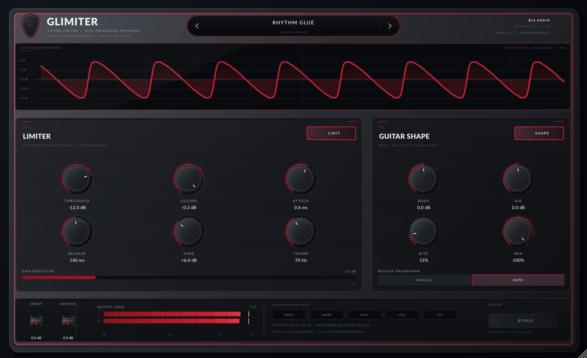

# GLimiter — Guitar Limiter

GLimiter is a guitar-first brickwall limiter (VST3 + Standalone) built with JUCE 8.0.8.
It is designed to control the peaks of an amp sim, pedal chain, or DI without
flattening the pick attack or ducking palm mutes.



## Why a guitar limiter is different

Guitar parts are dominated by fast pick transients and low-string thump. A generic
mastering limiter tends to over-react to palm mutes and to soften the attack that
makes a part feel alive. GLimiter addresses both:

- **Fixed 2 ms lookahead** with an attack control that uses the lookahead as a
  gain ramp. The reported latency never changes, and bypass is delayed by the
  same amount, so A/B switching stays phase-aligned.
- **Thump-filtered detector** (20–400 Hz) keeps low-string energy from pumping
  the whole part while a small full-band contribution still catches real peaks.
- **Programme-dependent AUTO release** recovers quickly after light limiting and
  more slowly after deep limiting.
- **Guitar shaping** before the limiter: BODY low shelf, AIR high shelf, and BITE
  saturation. SHAPE can be switched out independently of the limiter.
- **Absolute ceiling** with a soft safety stage. At 100% mix the output is
  asymptotic to the ceiling, even for hostile +18 dBFS input.
- **Mono and stereo** buses are supported, with a stereo-linked detector.

## Signal path

```
INPUT → BODY → AIR → BITE → THUMP-FILTERED DETECTOR → 2 ms LOOKAHEAD LIMITER → CEILING → MIX → OUTPUT
```

## Controls

### Limiter

| Control | Range | Default | Notes |
| :--- | :--- | :--- | :--- |
| Threshold | −48 … −0.5 dB | −12 dB | Onset of gain reduction; the ceiling cap still guarantees the absolute output peak. |
| Ceiling | −24 … 0 dB | −0.3 dB | Maximum limiter output at 100% mix. |
| Attack | 0.05 … 2 ms | 0.8 ms | Length of the gain ramp inside the fixed 2 ms lookahead. |
| Release | 10 … 1200 ms | 140 ms | Manual recovery time, or the base time in AUTO. |
| Knee | 0 … 18 dB | 6 dB | Soft-knee width around the threshold. |
| Thump | 20 … 400 Hz | 70 Hz | Detector high-pass; raise it to tame palm-mute pumping. |
| Release programme | MANUAL / AUTO | AUTO | AUTO adapts release to the amount of gain reduction. |
| LIMIT | on / off | on | Switches the limiter stage while keeping the requested latency. |

### Guitar shape

| Control | Range | Default | Notes |
| :--- | :--- | :--- | :--- |
| BODY | ±12 dB | 0 dB | Low shelf at 180 Hz. |
| AIR | ±12 dB | 0 dB | High shelf at 3.2 kHz. |
| BITE | 0 … 100% | 15% | Symmetric soft saturation that adds harmonics and shaves peaks. |
| MIX | 0 … 100% | 100% | Parallel blend of limited and shaped dry signal. |
| SHAPE | on / off | on | Bypasses BODY/AIR/BITE while leaving the limiter active. |

### Global

- **Input / Output**: ±24 dB, with 20 ms smoothing.
- **Bypass**: routes the raw input through the matching 2 ms delay.
- **Preset pill**: eight factory programmes, `<` / `>` navigation, and an EDITED
  indicator when a parameter changes.

## Factory presets

1. Rhythm Glue
2. Palm-Mute Tamer
3. DI Sparkle
4. Lead Sustain
5. Acoustic Bloom
6. Fuzz Wrangler
7. Ambient Swell
8. Safety Brickwall

## Build locally (Linux)

Dependencies are resolved offline from the sibling `plugin_poc` cache when it is
available:

```bash
./scripts/setup-linux.sh
./scripts/build.sh
```

Artefacts:

- `dist/GLimiter.vst3`
- `dist/GLimiter` (Standalone)
- `build/GLimiterTests_artefacts/Release/GLimiterTests`
- `build/GLimiterHostSmokeTest_artefacts/Release/GLimiterHostSmokeTest`
- `build/GLimiterScreenshot_artefacts/Release/GLimiter Screenshot`

## Verification

```bash
./build/GLimiterTests_artefacts/Release/GLimiterTests
./build/GLimiterHostSmokeTest_artefacts/Release/GLimiterHostSmokeTest dist/GLimiter.vst3
./scripts/render-ui.sh dist/glimiter-ui.png
```

The DSP suite covers latency, transparent below-threshold operation, brickwall
ceiling behaviour (including +18 dBFS input), latency-aligned bypass, dry mix,
limiter disable, thump filtering, BODY/AIR/BITE behaviour, mono, silence, and
auto-release recovery.

## CI / releases

`.github/workflows/build.yml` builds and tests on:

- Windows x64 (`windows-2022`, static MSVC runtime)
- Linux x64 (Ubuntu, Ninja)
- macOS Universal (`arm64;x86_64`, deployment target 11.0, ad-hoc signed)

Pushing a `v*` tag, or dispatching the workflow with a release tag, publishes the
three zip packages and SHA-256 checksums to a GitHub Release.

## Implementation notes

- `Source/dsp/GuitarLimiter.h` is a self-contained real-time engine: no
  allocation, locks, or file access in `process()`.
- UI telemetry uses `std::atomic<float>` values and a fixed 2048-entry waveform
  ring.
- The monitor waveform is decimated post-processing data written from the audio
  thread and polled at 30 Hz by the editor.
- UI rendering uses procedural JUCE `Graphics` only (no bitmaps) and the bundled
  Lato typeface (`Resources/Lato-OFL.txt`).

## Install

```bash
mkdir -p ~/.vst3
cp -a dist/GLimiter.vst3 ~/.vst3/
```

The standalone host in `dist/GLimiter` is useful for auditioning a DI or amp-sim
chain without a DAW. On Linux it opens the editor before touching the audio
backend, so a missing or stalled ALSA device does not hide the unit.
